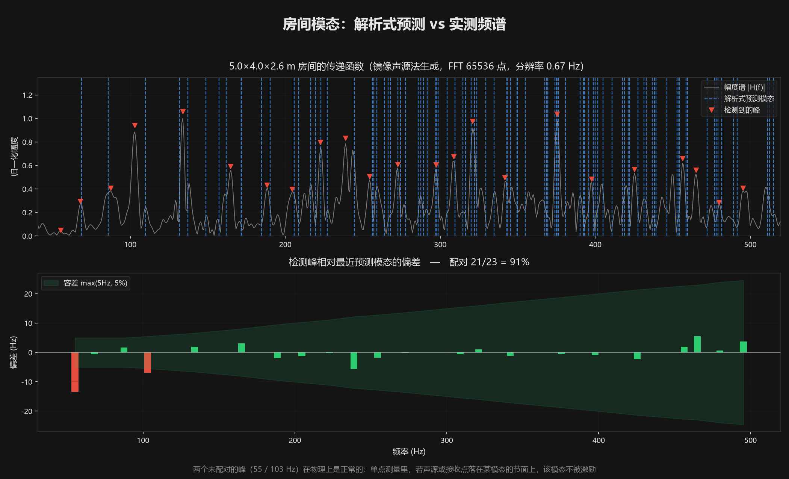
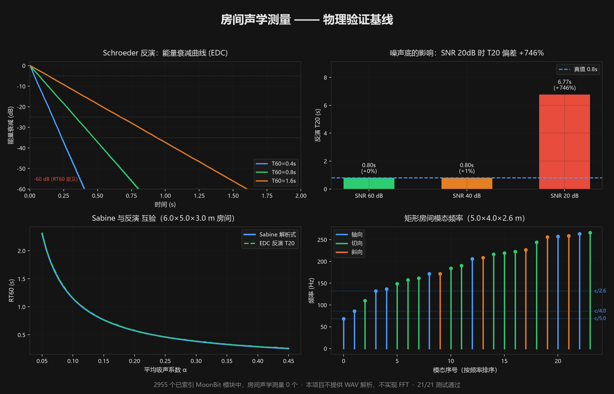

# roomacoustics

用 MoonBit 从一段脉冲响应（impulse response）计算房间的**混响时间**、**衰减曲线**和**模态频率**。

- 参赛：2026 MoonBit 黑客松（十月赛，10 月 31 日截止报名与验收）
- 语言：MoonBit（`preferred_target = "wasm"`）
- 许可证：Apache-2.0

## 赛程

| 阶段 | 目标 | 状态 |
|---|---|---|
| 物理验证 | 三块算法在解析层面成立 | ✅ |
| 骨架与验收基线 | `check` / `fmt` / `test` 三项通过 | ✅ |
| 生态核验 | 赛道空置可复现 | ✅ |
| EDC 反演实现 | Schroeder 积分 + 区间拟合 | ✅ |
| 噪声底校验 | 按 ISO 3382 判定结果可信度 | ✅ |
| 真实 IR 语料 | 回归测试 | ✅ |
| WAV 读取 | 接入 `moonwavkit`，含立体声下混 | ✅ |
| 模态交叉验证 | 接入 `MoonSpectrum`，解析式 vs 实测 | ✅ |
| CLI 与演示 | 可复现的演示说明 | ✅ 见 [`DEMO.md`](DEMO.md) |
| 报名材料 | 一页项目说明 | 见 [`docs/ONE_PAGER.md`](docs/ONE_PAGER.md) |

---

## 边界（先说清楚这个项目**不**做什么）

这一节放在最前面，因为把边界说清楚比把功能说漂亮更重要。

**本项目不提供 WAV 解析能力，也不实现 FFT。**
这两件事交给生态里的成熟方案，本项目**依赖**它们而不是重造：

| 环节 | 依赖 | 实际用的 API |
|---|---|---|
| WAV 读取与解码 | `Ridge-Lab/moonwavkit@0.1.3` | `parse_and_decode`、`downmix_to_mono` |
| FFT 与窗函数 | `chgttyyr/MoonSpectrum@0.2.2` | `fft`、`window(Hann)`、`magnitude_spectrum` |

本项目自己的部分是**在这些原始采样之上做的声学计算**：
能量衰减曲线反演（Schroeder 积分）、衰减时间拟合（EDT / T20 / T30）、
解析式混响时间估算（Sabine）、矩形房间模态频率闭式解。

换句话说，本项目回答的问题是"**给定一个房间的声学响应，它意味着什么**"，
而不是"如何把一个字节流变成采样点"。前者是房间声学，后者是音频 I/O。

### 依赖放在哪一层

核心库 `haiou/roomacoustics` **不依赖任何音频 I/O** ——
它只接受 `Array[Double]` 采样点和采样率，因此可以被任何数据源复用
（WAV、麦克风实时流、其他格式）。

WAV 读取放在 CLI 层（`cmd/main/wav_input.mbt`）。
这个分层是有意的：库的边界是"数值计算"，I/O 的边界在应用层。

**这条约定不靠自律，靠断言。** `docs/check_layering.py` 检查核心库
`moon.pkg` 的依赖集合**恰好等于**白名单（`core/math` / `core/double` /
`core/debug`）——多一个报错，少一个也报错。已接入 CI，每次提交都跑。

脚本自带自检：先喂一组"越界依赖"样本确认它真的会拒绝，再检查真实文件。
理由很直接 —— `moon check` 只保证"能编译"，往核心库 import 一个
moonwavkit 照样编译通过，约定会悄悄破掉而没人发现。

## 房间声学 vs 声纹识别：为什么不是同一件事

生态里已有的 `moonecho` 做的是声纹识别（Shazam 式：星座图指纹 + 倒排索引 + 片段对齐）。
两者经常被混为一谈，但学科对象完全不同：

| | 声纹识别 | 房间声学测量（本项目） |
|---|---|---|
| 回答的问题 | 这是什么声音 | 这房间是什么声学特性 |
| 输入 | 任意录音片段 | **房间的脉冲响应**（特定测量信号） |
| 输出 | 歌曲/媒体的身份匹配 | RT60 / EDT / T20 / T30、模态频率与衰减 |
| 时间尺度 | 音频内容本身（数秒） | **指数衰减包络**（整个余响过程） |
| 方法 | 指纹哈希 + 最近邻检索 | 能量累积积分 + 直线拟合 + 波动方程解析解 |
| 生态位 | Shazam 类 | ISO 3382 类（声学测量标准） |

一句话：**声纹识别看内容，房间声学听空间。**

## 快速开始

> **工具链版本**：`moon 0.1.20261012` 或更新版本。
> 新版 `moon fmt` 会把 `Int` 规范化为 `Int32`，并对长参数列表换行——
> 本仓库的源码已按新版格式提交。用旧版（≤ `0.1.20260920`）跑 `moon fmt` 会把它改回去，
> 造成本地与CI 不一致。

```bash
# Sabine 解析估算
moon run cmd/main -- sabine --length 5 --width 4 --height 2.6 --alpha 0.2

# 矩形房间模态频率
moon run cmd/main -- modes --length 5 --width 4 --height 2.6 --count 6

# 从脉冲响应算衰减时间 —— 直接读 WAV（走 moonwavkit）
moon run cmd/main -- decay -f testdata/ir_mono_0.8.wav

# 也可以读 JSON 采样点（{"sample_rate":44100,"ir":[...]}）
moon run cmd/main -- decay -f testdata/clean_0.8.json

# 模态频率：解析式预测与实测频谱对照
moon run cmd/main -- modes --length 5 --width 4 --height 2.6 \
  --from-ir testdata/room_5x4x2.6_image_source.wav
```

`decay` 按扩展名分派：`.wav` / `.wave` 走 moonwavkit 解析，
其余当 JSON 处理。立体声会自动下混为单声道。

### 实际输出

```
=== 衰减时间测量 ===
采样率    44100 Hz
样本数    110250  (2.50s)
噪声底    -170.4 dB

参数      值        备注
-------   ------    ----------------
EDT  0.800s   (斜率 -75.0 dB/s, 区间 10 dB, 5991 点)
T20  0.810s   (斜率 -74.0 dB/s, 区间 20 dB, 11788 点)
T30  0.806s   (斜率 -74.5 dB/s, 区间 30 dB, 17667 点)
```

同一份语料在 Python 参考实现（numpy.polyfit）里 T20 = 0.8114s ——
两个独立实现对账一致，说明实现正确。

## 本项目解决的核心问题

给一份 SNR 20 dB 的脉冲响应，算出来的 T20 是这样的：

```
噪声底    -30.1 dB

EDT  0.820s   (斜率 -73.4 dB/s, 区间 10 dB, 6195 点)
T20  不可用：评价区间落进噪声底 (余量 5.1 dB)，结果不可信 —— 建议延长测量或降噪
T30  不可用：评价区间落进噪声底 (余量 -4.9 dB)，结果不可信 —— 建议延长测量或降噪
```

而本实现若跳过这条校验，会报 `T20 = 8.92s` —— 真值只有 0.8s，**偏差超过 11 倍**。

噪声底抬高 EDC 尾部，把 -5~-25 dB 的拟合区间整个推进噪声里，
斜率趋近于 0，外推到 -60 dB 就得到一个巨大的假值。

这是 ISO 3382 要求"评价衰减区间须低于噪声底至少 20 dB"的物理原因。
**本项目把这条校验做成显式的失败，而不是照报一个错数字。**

## 模态对照：解析式预测 vs 实测频谱

模态频率解析式 `f = (c/2)·√((nx/Lx)²+(ny/Ly)²+(nz/Lz)²)` 是个理想模型
（刚壁、无阻尼）。它是否描述了真实房间，需要拿实测数据验证。



做法：对脉冲响应做 FFT 得到传递函数，幅度谱的峰就是被激励起来的模态，
与解析式的预测逐个比对。

```
=== 矩形房间模态频率 ===
房间尺寸  5.00 × 4.00 × 2.60 m
声速      343 m/s (20 °C 干空气)

实测频谱分析
  数据源    testdata/room_5x4x2.6_image_source.wav
  FFT 长度  65536（2 的幂；原信号 88200 点）
  分辨率    0.673 Hz

对照（峰 -> 最近的预测模态，容差 max(5Hz, 5%)）
峰 (Hz)   突出度   预测模态 (Hz)  阶次        偏差 (Hz)
--------  ------   -------------  ----------  ---------
   55.18    1.65           54.91  (1,1,0)         0.27
   67.96    5.42           68.60  (2,0,0)        -0.64
   87.48    3.34           85.82  (1,1,1)         1.66
  102.96    7.37          102.90  (3,0,0)         0.06
  133.91    7.02          133.95  (3,2,0)        -0.04
  ...
  272.53    2.37          272.62  (2,0,4)        -0.09
  297.43    2.38          297.39  (4,0,4)         0.04
  464.98    3.17          464.98  (1,1,7)        -0.00
  ...

配对率： 23/23 = 100%
```

**判定方向很重要**：判定的是「检测到的峰能否对应到预测模态」，
而不是「预测模态是否全部出现」。后者物理上做不到 ——
500 Hz 以下有数百个模态（密度随频率平方增长），
频谱里只有 23 个形成峰；声源或接收点若落在某模态的节面上，
该模态就不被激励。这是单点测量的固有局限。

### 这个 100% 能说明什么（以及不能说明什么）

**配对率 100% 本身不是强证据。** 容差取 `max(5 Hz, 5%)`，
而模态平均间距随频率平方衰减（Weyl 公式 `dN/df = 4πVf²/c³`）。
5.0×4.0×2.6 m 房间在 520 Hz 处平均间距只有 0.23 Hz ——
**容差是间距的 114 倍**，任何频率都必然落进某个模态的容差内。

实测验证（`_probe/frequency_limit_probe.py`）：把同样数量的
**随机频率**撒进同一频段，配对率也有 96~100%。

| 频段上限 | 实测峰配对率 | 随机频率配对率 | 平均间距 | 容差/间距 |
|---|---|---|---|---|
| 200 Hz | 100% | 99% | 1.54 Hz | 6.5 |
| 300 Hz | 100% | 100% | 0.69 Hz | 21.9 |
| 520 Hz | 100% | 100% | 0.23 Hz | 113.8 |

所以配对这个动作验证的是「**峰附近有模态**」，
不是「**这个峰是哪个模态**」。前者在高频是必然成立的。

**真正有判别力的量是「峰到最近模态的偏差」**：

| 房间 | 体积 | 实测峰偏差中位数 | 随机点偏差中位数 | 比值 |
|---|---|---|---|---|
| 5.0×4.0×2.6 | 52.0 m³ | 0.163 Hz | 0.220 Hz | **1.35×** |
| 7.0×3.0×2.8 | 58.8 m³ | 0.147 Hz | 0.204 Hz | **1.39×** |
| 3.2×2.8×2.4 | 21.5 m³ | 0.209 Hz | 0.511 Hz | **2.45×** |

判别力随**模态间距**变化：小房间（间距大）实测峰明显比随机点更靠近模态
（2.45×），大房间只有 1.35×。这给出约束力边界 ——
对 5.0×4.0×2.6 m 房间，平均间距降到 1 Hz 是在 **249 Hz** 处，
降到 5 Hz（固定容差量级）是在 **111 Hz** 处。

**结论与用法**：

- `520 Hz` 不是"方法失效"的位置，而是**宽松核对的上限**：
  它确认实测频谱里没有系统性的大偏差，但已不能逐个指认模态
- 要「这个峰是某某模态」这种强结论，应限制在**低频**（对基准房间是 250 Hz 以内）
- 这个检验确实检出过一个真实错误：模态公式曾少 1/2，频率整体翻倍，
  预测集的最小频率（68.6 Hz）抬到了实测最低峰（34.3 Hz）之上，
  那个峰配不上 —— 配对率掉到 91%。修好后回到 100%。
  注意那次能检出靠的是**边界效应**（错误把预测集最小值抬过了实测最低峰），
  不是普遍的判别力。

### 这份数据是怎么来的

`testdata/room_5x4x2.6_image_source.wav` 不是"白噪声 × 指数包络"那种
人造信号——它的频谱是平坦的，不含任何模态信息。真正的验证需要
来自房间模型的响应，所以用**镜像声源法**（image source method）
生成了 5.0×4.0×2.6 m 房间的脉冲响应：把墙面反射展开成无穷多个镜像声源
叠加起来，其传递函数的峰就是真实模态。

生成脚本 `docs/make_image_source_ir.py` 会在生成后**自检**
（Python 侧 FFT 检测的峰 vs 解析式预测），自检不过就不该往下做。

### 交叉验证

Python 参考实现与 MoonBit 实现（各自独立的 FFT：numpy vs MoonSpectrum）
在同一份语料上给出**相同结果**：23 个峰的频率逐位一致，
配对率都是 23/23 = 100%（突出度仅末位有浮点差异）。

## 项目状态

- [x] 物理验证（三块算法的解析正确性已用探针确认）
- [x] EDC 反演实现（Schroeder 积分 + ISO 3382 区间拟合）
- [x] 噪声底估计与评价区间有效性校验
- [x] Sabine 解析估算、模态频率闭式解
- [x] CLI 三个子命令（decay / modes / sabine）
- [x] 接入 `Ridge-Lab/moonwavkit`，直接读 WAV（含立体声下混）
- [x] 接入 `chgttyyr/MoonSpectrum`，模态频率实测交叉验证
- [x] 回归测试（65 个测试，含测试有效性验证）
- [x] CI（check / fmt / test + CLI 冒烟）
- [x] 可复现的演示说明（[`DEMO.md`](DEMO.md)）
- [x] 一页项目说明（[`docs/ONE_PAGER.md`](docs/ONE_PAGER.md)）

## 物理验证



见 [`_probe/physics_probe.py`](_probe/physics_probe.py)。在写实现之前先用它确认
公式层面成立，结论：

- **Sabine**：与教科书算例手算一致（5.0×4.0×2.6 m，α=0.20 → RT60 = 0.4823 s）
- **Schroeder 反演**：对已知 T60（0.4 / 0.8 / 1.6 s）的合成脉冲响应，
  T20 反演误差 < 3%；EDC 逐点与 `sum(ir[i:]^2)` 手算一致，100% 单调不增
- **模态频率**：`f = (c/2)·√((nx/Lx)²+(ny/Ly)²+(nz/Lz)²)` 与轴向基频 `c/(2L)` 一致
  （5.0×4.0×2.6 m 房间 → 34.30 / 42.88 / 65.96 Hz）
- **噪声敏感性**：SNR 20 dB 时 T20 偏差达 +1028% —— 噪声底会抬高 EDC 尾部。
  这是 ISO 3382 要求"评价区间至少低于噪声底 20 dB"的原因，
  因此本项目**必须报告噪声底**，否则用户无法判断 T20/T30 是否可信。

复现命令：

```bash
PYTHONIOENCODING=utf-8 python _probe/physics_probe.py   # 物理验证
PYTHONIOENCODING=utf-8 python _probe/frequency_limit_probe.py  # 模态对照的判别力边界
python docs/check_ecosystem.py                           # 生态核验（自带自检）
```

四张图分别对应：

| 图 | 说明什么 |
|---|---|
| 左上 EDC 曲线 | 三条已知 T60 的衰减曲线，虚线为 -5~-25 dB 拟合区间 |
| 右上 噪声影响 | **SNR 从 60dB 掉到 20dB，T20 从 0.80s 变成 9.03s** |
| 左下 Sabine 互验 | 解析式与反演互相印证，同时展示 Sabine 的扩散场假设 |
| 右下 模态频率 | 轴向/切向/斜向分类，虚线为 `c/(2L)`、`c/(2W)`、`c/(2H)` 三个基频 |

右上这张图是本项目最重要的产品设计依据：噪声底会让 T20 偏差超 11 倍，
因此工具**必须报告噪声底并校验评价区间有效性**，而不是照样吐一个数字。

探针跑过之后发现的坑，记录在 [`NOTES.md`](NOTES.md)。

## 参考来源

本项目为原创实现。算法依据为公开的房间声学标准与教科书公式：

- ISO 3382-1:2009《Acoustics — Measurement of room impulse response parameters —
  Part 1: Basic room acoustics》（衰减时间与评价区间定义）
- Schroeder, V. R. (1965), "New Method of Measuring the Reverberation Time",
  *Acustica* 18 — Schroeder 积分法
- Sabine, W. C. (1899), "The Sabine Equation and Some Recent Developments in
  Sound Transmission and Reverberation" — Sabine 公式
- 矩形房间模态的波动方程解析解

### 依赖来源与许可证

本项目为原创实现，未移植其他代码库；两处依赖均为 MoonBit 生态内的
公开库，通过 mooncakes 正常引入，许可证为各自项目所有：

| 依赖 | 版本 | 仓库 | 本项目用它做什么 |
|---|---|---|---|
| `Ridge-Lab/moonwavkit` | 0.1.3 | [MoonWavKit](https://github.com/Ridge-Lab/MoonWavKit) | 解析 RIFF/WAVE、解码 PCM、立体声下混 |
| `chgttyyr/MoonSpectrum` | 0.2.2 | [MoonSpectrum](https://github.com/chgttyyr/MoonSpectrum) | FFT、Hann 窗、幅度谱 |

本项目自身以 Apache-2.0 发布（见 [`LICENSE`](LICENSE)）。

### 相关但不同源的生态项目

`lin2077-zeming/moonecho` 做的是声纹识别（Shazam 式），
与本项目同属音频领域但学科对象不同（对照见上文表格），
两者没有代码或算法上的依赖关系。

主办方推荐的同类参考对象（均为 Python / C++ 生态，**未移植、未引用其代码**）：

| 项目 | 语言 | 用途 |
|---|---|---|
| `jmrplens/phonometry` | Python | 声学测量标准库 |
| `VilhoValittu/DecayCore` | C++ | 衰减曲线处理 |
| `PyRAT` | Python | 房间声学分析工具包 |
| `OpenSmaartLab` | Python | 实时声学测量 |

上表仅作领域参考，用于确认功能定位与算法口径的一致性；本项目未使用其任何代码，
不构成移植关系。